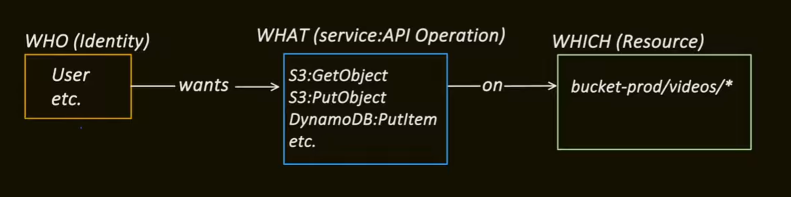

# IAM

IAM : Identity and Access Management

Identity X wants to perform action y on resource z, should we allow it or not, it is decided by IAM

I might get confused again if i am reading this again, but the user here is not the end user, it is a developer or devops or non tech person or even our springboot application, does these users have permission to view or perform certain operation on a certain resource is the question

By default in AWS, every API call is denied by default, if we want someone to access a resource, then we have to explicitly grant the permission, this is where IAM comes into picture

** root user has unlimited power, it has even the power to delete the account, that is why using the root user credentials across a team is extremely riskly because everyone gets unrestricted access with no proper isolation or accountability

IAM Entities :

1. USER :

    as mentioned earlier, user can be a application, long lived program, or even a human like developer, devops, each user has a unique identifier called the ARN(Amazon Resource Name), and we can have user name and password, or if you want to use this in an application, then we can get access key id and secret key as well and each user has certain permissions
