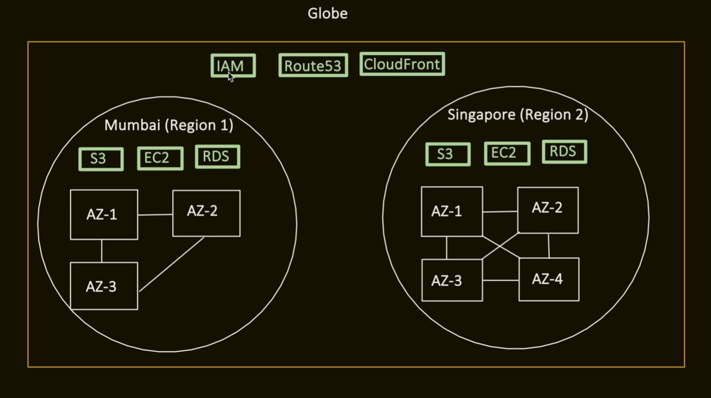
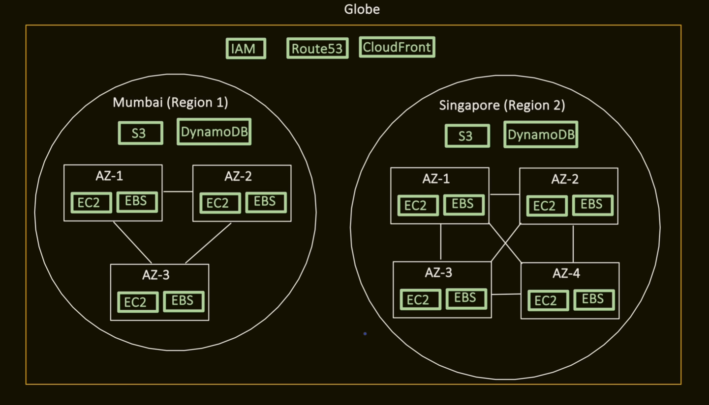
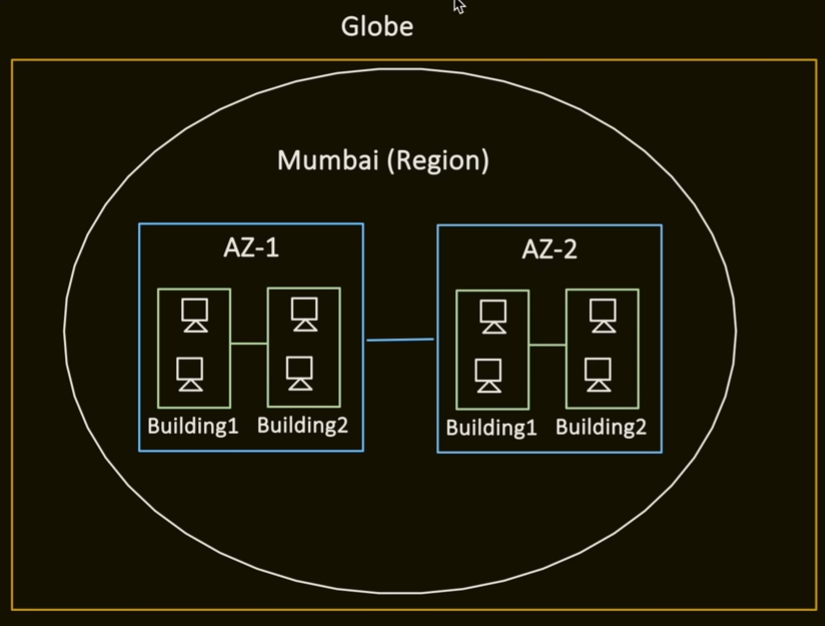

# Infrastructure

1. Region :
    region is like a city have a cluster of availability zones

    many AWS services are regional and data does not automatically replicate across regions unless explicitly configured
    eg : Regional services : means servies created in region 1, other regions cannot automatically see it
    ec2, rds, lambda etc

    and there are global servies which means servies shared across all regions
    IAM, CloudFront(CDN), Route 53(DNS) etc

    

    Now, if we go futher down, we have availability zones as well, and there can be zonal services and regional services but not zonal services

    zonal servies : means servies created in 1AZ is not replicated to other AZ's in the same region
    eg : EC2, EBS etc

    Regional but not zonal : means regional services with AWS managed Multi-AZ availability, these services operate at region scope, and AWS automatically handles replication across multiple AZ's
    eg : S3, DynamoDB, Lambda etc

    

    why Region exist :
    Latency : closer = faster, if users and servers both are in india, we can provide low latency service
    if users from india is served from servers located in USA, there will be latency add up for data travel time

    compliance : many countries like chine/india etc require certain data to stay in country
    disaster isolation : flood in region1 will no affect region2, both are completely independent and isolated

2. Availability Zone :

    you can imagine AZ as a building( or group of buildings ) in which physical servers are kept, this where ultimately every service and every application recides

    

    generally region has >=3AZ's

    why do we need multiple AZ's?????
    Multiple AZ is required to survive single data center failure, if our application runs in only one AZ and that AZ goes down , we're offline, if it runs in two AZ's the other one keeps serving

    important points to notice here are generally 2AZ's are generally 10-100Km apart, close enough to be fast and far enough that one disaste can not hit both, each AZs power source, cooling, Network are independant and Two AZs within a region are connected via private fiber cables, so that round trip latency is in single digit millisecond(<1ms most of the time)

3. Local Zone :
    lets see a use case where lot of my users are in kolkata, and my servies are in the mumbai region, they are like 1500Km from kolkata, so round trip costs and increases latency, so in this what we can do is have a local zone which is a set of servers running some services like EC2 or EBS, in kolkata, this way latency will decrease, but what if most requests are calling the DB, it has to ultimately go to the mumbai location servers, so we have to carefully decide if we want local zones or not based on our request patterns and all

4. Edge location or Points of presense(POP) :

    it is kind of configuration instead of us deploying a service there, we just opt that we want it or not, edge locations can run services like DNS(route53), CDN(cloudflare), and amazon shield

    so if you opt these services, you have to pay for these as well, but if your product is something like a majority static data like OTT platforms, then you can opt for CDN which brings down the latency significantly, and if you have multiple servers running in different regions, you can use the DNS to return ip address to the client based on may be the nearest region, or available region, or some other configuration
