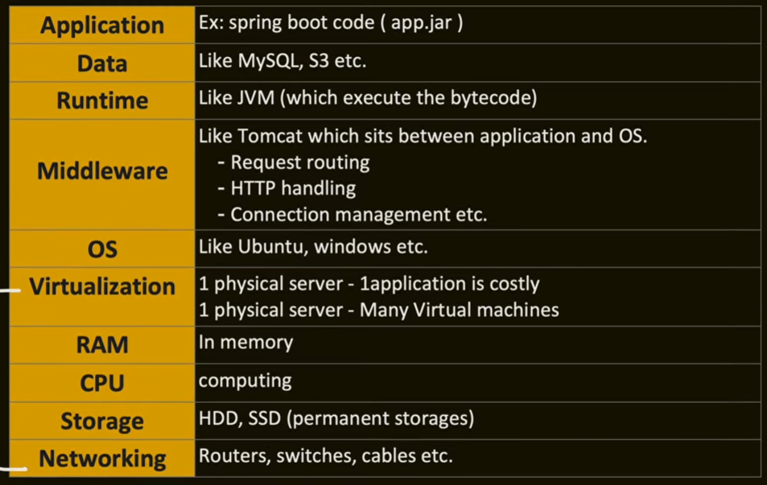

# Introduction

so in the old times, when you want to host an application, people used to have their own servers, own connections, own management of all these servers, but modern cloud providers have changes the game, they provide whatever you want, you just have to deploy your application there, and configure some setting

what does the modern cloud providers provide

lets consider this requirements chart :

1. IAAS : infrastructure as a service
    IAAS provides Virtualization, Server(CPU,RAM), Storage and Networking, and the remaining are handled by the user, from OS to application
    eg : EC2, after we launch a EC2 we have to install Ubuntu, Java, MySQL, setup load balancer and deploy our application

2. PAAS : platform as a service
    this provides everything except the application and data, rest everything is taken care by the cloud provider, generally this is for users which are in small scale, they just want to deploy their application, they dont want to change or play with the configurations
    eg : AWS Elastic Beanstalk

    so all you have to do is upload your jar, internally AWS will create everything else for us like EC2, OS, Java runtime, Tomcat, Load balancer, security, scaling etc

    the issue with PAAS is the application might work in the client machine but may fail on the cloud, because the java version could be different, the env variables could be different, as PAAS does all these automatically, this issues could be faced, this is where containers come into picture, containers are self sufficient, they could run on their own without any system configuration, because dependencies are containarized along with the application code

3. CAAS : container as a service
    so all you have to do is give your docker container and give your configurations like how many containers you want, CPU/RAM requirements and Scaling rules, the CAAS will take care of which VM should run the container, fault tolerance, Scaling and load balancing

    eg : Kubernetes, ECS, EKS

4. FAAS : function as a service
    Lets consider the system design of youtube example, we have talked about convertion of 4k video into multiple versions like 1080,720.480 and so on, we could write a function to do this and deploy on FAAS, we use FAAS when the task is short lived and it is event driven

    eg : AWS lambda

5. SAAS : software as a service
    like your webex, or teams or mail, you just use the product and pay for the usage