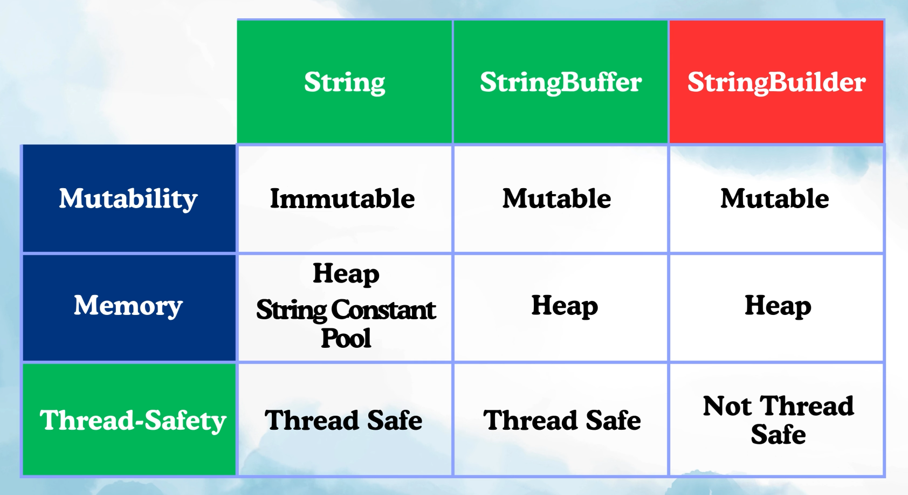

# string, string buffer and string builder

whyy three different types to store text values??? even through all of them store text values, but each one behaves differently, and those differences dictate which one should be used when

1. mutability
    strings are immutable, the original string remains the same, if we assing a different string, then new string is stored in the heap if created using the new key word, or in the string constant pool if created using the string literal

    stringbuffer and stringbuilder are mutable, so the string itself changes

2. memory
    strings can be stored in two places, heap memory if created using the new keyword, and string constant pool if created using string literals

    stringbuffer and stringbuilder are stored in heap memory only

    important thing to notice here is the .equals method is overriden in the string class, but not in the stringbuffer and stringbuilder class so they work the same as ==(checks the addresses)

3. thread safety
    strings are thread safe
    stringbuffer is thread safe
    stringbuilder is not threadsafe

    the lehman explanation for why this behaviour happens is that there is a initial value a = "hello", both the threads read this and changed this to something else, lets say t1 changed it to "helloworld" and t2 changed it to "hellouniverse", now when they write, the final value depends on which thread wrote it last, so because stringBuilder allows threads to write without any locking mechanism, this is not thread safe

*** when you do something like string c = a + b, this happens at run time, so java internally does something like c = new StringBuilder().append(a).append(b).toString() so the result will be saved in the heap memory, as no literals are used here, no string will be stored in the string constant pool apart from a and b if they are literals